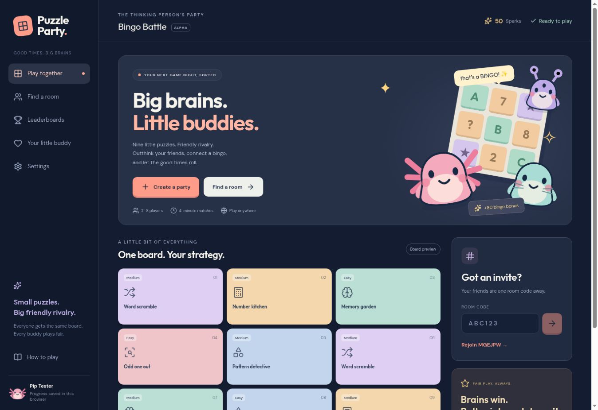

# Puzzle Party · Bingo Battle

**[▶ Play the hosted game](https://puzzle-party-bingo.spryibex35.chatgpt.site/)**

A cozy multiplayer puzzle showdown for **2–8 players**. Solve word scrambles, arithmetic, memory gardens, patterns and odd-one-out challenges on a shared 3×3 board. Four-minute rounds; each bingo line adds 80 points. Everyone receives the same puzzles and no first-answer bonus.



## Included

- Public and private rooms; room codes and invite links
- Casual easy/medium puzzles, local responsive input and server-validated scores
- Guest weekly and all-time ranked leaderboards; no sign-in
- Six original animal/alien avatars, cosmetic rewards and character reactions
- Room text chat and optional WebRTC audio: open mic or remappable push-to-talk
- Desktop and mobile layouts
- 42 automated engine/API checks and an opt-in live smoke test

## What survives deleting a chat?

This repository contains the complete application source, lockfile, database migrations, original artwork and tests. Clone or download it without needing the chat. The Play link above points to the existing Sites deployment; this repository is **not itself a second hosted multiplayer server**, and it does not back up that server's live player data. To own an independent live copy, deploy this repository to your Cloudflare account below. A new database starts with empty rooms and rankings.

**GitHub Pages alone cannot host this game's backend or database.** The README Play link opens the currently hosted game. The GitHub Actions deployment workflow can deploy a separate full game to Cloudflare Workers + D1 after you configure your account.

## Run locally

Use Node.js 24 and pnpm 11.25.0. In a new checkout:

```sh
pnpm install --frozen-lockfile
pnpm test
pnpm typecheck
pnpm build
pnpm db:local
pnpm start
```

Open the local URL Wrangler prints. The generated local D1 database persists in `.wrangler/`. For UI development use `pnpm dev`; do not expose the dev server publicly. Test separate players using different browsers or private browsing sessions (one guest identity per cookie jar). Use HTTPS for microphone access outside localhost.

## Deploy your own independent copy

1. Create a Cloudflare account and authenticate: `pnpm exec wrangler login`.
2. Create a database: `pnpm exec wrangler d1 create puzzle-party-db`.
3. Copy the returned database ID and build using it:

```sh
export CLOUDFLARE_DATABASE_ID="YOUR_D1_DATABASE_ID"
pnpm build
pnpm deploy
```

On PowerShell use `$env:CLOUDFLARE_DATABASE_ID="YOUR_D1_DATABASE_ID"` instead of `export`. The deployment script applies the versioned migrations before deploying the Worker and prints the public URL. It refuses to deploy the local placeholder database ID. Check current Cloudflare quotas and pricing before deploying. No ChatGPT runtime, account or secret is required by this standalone version.

### Deploy from GitHub Actions

In this repository's **Settings → Secrets and variables → Actions**, configure:

- Secret `CLOUDFLARE_API_TOKEN`: a token scoped to your account with Workers Scripts Edit and D1 Edit permissions.
- Secret `CLOUDFLARE_ACCOUNT_ID`: your Cloudflare account ID.
- Variable `CLOUDFLARE_DATABASE_ID`: the ID of the D1 database you created.

Then open **Actions → Deploy to your Cloudflare account → Run workflow**. This is manual; regular pushes only run checks. Never commit API tokens, cookies or `.env` files. After deployment, update the Play link in this README to your independent Worker URL.

## Architecture and limitations

`app/page.tsx` implements the responsive UI. `game/engine.ts` generates puzzles and scores results. `app/api/game/route.ts` handles cookie identity, optimistic room updates, rankings, chat and voice signaling. `drizzle/` holds schema migrations. `components/game/Avatar.tsx` contains original vector art. `components/game/voice.ts` handles audio connections.

Guest progress belongs to a browser cookie. Clearing cookies or switching devices creates another profile; this is not a hardened anti-cheat system. Voice uses STUN without a TURN relay, so some networks will not connect. No audio recording is implemented. Physical-device and independent-network audio testing remain necessary. Results finalize on a request after the deadline. Production data is not stored in Git: export your own D1 database separately for backups.

The standalone export removes the Sites build integration and ignores Sites identity headers. It retains the same game rules. Any optional leftover template utilities are not part of the standalone runtime.
